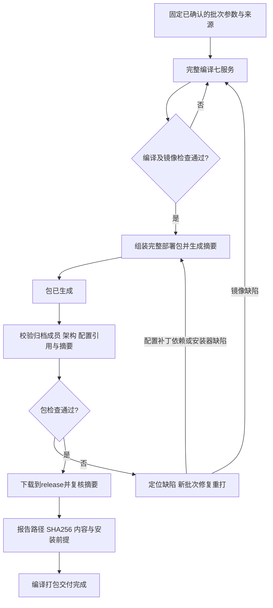

# CloudMeet 编译、打包、部署统一规范（唯一规范源）

## 1. 效力与执行责任

本文件独立、完整地规定本工作区 CloudMeet 服务端及客户端的编译、打包、发布、安装、更新、验收与回滚规则。执行者必须遵守，不得通过新增脚本、改变架构、改用技能或测试拓扑规避。获得完整规范不需要阅读其他文档；不得把本文件未写明的强制要求委托给其他文档。

README 仅导航材料和报告实际状态；技能仅提供操作方法；检查脚本中的路径清单仅登记实现；包内 INSTALL 仅描述该包的实测操作；测试提供验证证据。它们都不是并列规范源，不得新增、放宽或覆盖本文件的要求。发现实现与本文件冲突时停止受影响步骤并报告，不能自行选择较宽松规则。根级安全、授权和环境保护要求仍须遵守。

## 2. 批次范围与授权

- 开始一次批次时记录目标 OS、架构、完整 origin（协议/主机/端口）、媒体地址与端口、安装路径、源码或镜像来源、服务/补丁/客户端范围及终点。复用已确认选择，不反复询问。
- 七服务为 gateway、app-web、api、web（Jitsi）、prosody、jicofo、jvb。不得用“七镜像构建成功”代替完整产品配置。
- amd64、arm64 共用产品要求；架构差异限镜像、工具、依赖及经验证的平台参数。不能默默关闭鉴权、丢弃品牌或角色能力。缩减功能的测试包必须获得明确范围授权，不得当作正常产品交付。
- 仅执行用户要求的里程碑，整批验证，不每小步停下。不得顺带整改广泛 CVE、升级依赖/锁文件、清理缓存或执行无关服务器操作；风险单列，遇具体阻塞或新授权边界才询问。

## 3. 目录与唯一流程

- `deploy/release/` 是唯一新增交付入口，架构名称使用 `amd64`、`aarch64`。不再建立或下载到 `deploy/debug/`。release是交付用途，不等同编译器构建模式或签名身份。
- `release/<架构>/server/` 放编译组包及材料完整性校验通过的完整服务器包，`clients/` 放客户端构建产物并注明OS/ABI和签名，`dependencies/` 放按OS/版本区分的Docker、Compose依赖。缺必需材料的未完成候选留Actions，不作为完整包交付。完整包附构建/校验记录、INSTALL、摘要和前置条件；不以安装测试作为进入release的条件。
- 架构按产物本身而非其连接的服务器划分。客户端注明 OS/ABI；多ABI包记录实际支持集合，不冒称单架构。依赖在 dependencies 下按目标OS/版本和组件版本区分，记录来源、摘要、安装前提及验证状态；有安装材料不等于该平台安装通过，不授权覆盖已有引擎。
- 目录调整：用户明确授权删除deploy/debug及全部内容，不迁移其中候选包和证据。旧 `packages/`、`history/`、`artifacts/`、`releases/`、根 `clients/` 和 `offline-packs/` 不在此次删除范围。现有工具可能仍输出旧路径，不能声称已完成工具迁移；发现旧debug输出须先停用，不得重建目录。
- `config/` 用于人工维护公共配置，现有 `artifacts/nginx.conf` 尚未迁入；旧 `releases/` 为镜像候选登记、`offline-packs/` 为既有引擎材料，均不是另一条正式交付主线。
- `patches/` 是公开补丁维护源；`artifacts/` 是模板所需生成物暂存及路由配置；`tools/`、`tests/` 是维护工具和测试；`.worktrees/` 是独立 Git 工作树，不随整理移动或清除。
- 编译和组包工具留在 `build-tools/`；服务器构建/组包的位置按第4节已确认执行路线，不能默认改用WSL。WSL仅承担已授权的辅助脚本/测试与文件检查；Windows构建客户端。不得移动业务源码进deploy，不重建根级delivery-history或cloudmeet-deploy-offline。
- 根级 init.py、start.sh、Compose 是过渡模板，不是通用离线包；未更新全部调用与测试前保留位置。不得对离线安装套用在线 pull 流程。
- `build-tools/offline-runtime/` 是公共安装核心的收敛目标，尚非全部平台自动合格。禁止按架构新增独立精简产品安装逻辑。新增/替换入口必须登记调用关系、适用范围及测试，并证明继承全部产品要求；登记本身不放行。
- `build-tools/kylin-arm64/install.py` 与 `assemble-kylin-arm64-wsl.py` 因漏装产品补丁和 no-auth 配置，当前禁止继续产品交付；保留用于诊断。ARM CI 的 no-auth 控制面拓扑不得升级为产品运行基线。修复必须新建批次，不能靠改状态字段恢复资格。
- `packages/**` 及历史批次字节、日志、签名、摘要、旧路径不可原地修改。保留 old_deploy、openeuler-arm-deploy，不在整理时清理。现有包保留其限定平台和范围的历史证据，不因新登记升级资格。

### 3.1 人工维护目录及文件职责清单

下列路径均相对 `deploy/`。本清单直接说明职责，不把其他文档作为补全规范的前置阅读。新增、改名、迁移人工维护的文件或目录时，必须同步更新本清单与调用测试；不得先创建另一条部署线后补登记。

**枚举边界：**人工维护的脚本、配置、补丁、说明、技能及测试逐文件列明。编译生成物、下载的二进制、缓存、Git 内部文件、历史批次生成内容不逐文件枚举；只定义所在目录的职责和保护边界，不要求预知未来产物名称。生成文件不能反过来充当新的规范源。

#### 根目录文件与特殊目录

| 路径 | 作用 |
|---|---|
| `AGENTS.md` | 本文件，编译/打包/部署唯一完整规范源 |
| `README.md` | 材料入口、批次路径及实际状态导航，不另立规则 |
| `.gitignore` | 维护仓库跟踪白名单，排除产物、实例秘密和数据；不得强制添加绕过边界 |
| `SHA256SUMS` | 已有根级材料的校验清单，不代表所有未来包的完整性或产品资格 |
| `config/Caddyfile` | 公共网关模板：IP HTTPS 私有CA、业务/会议路由、内部接口隔离及参数化HTTP重定向；根Compose挂载此文件，组包读取后生成包内Caddyfile，不含实例IP |
| `config/docker-compose.yml` | 网关、业务Web/API与Jitsi配置覆盖；由config/start.sh在config/jitsi-base.yaml之后合并，显式project-directory为deploy根，不能单独当完整配置 |
| `config/jitsi-base.yaml` | 过渡模板 Jitsi web、Prosody、Jicofo、JVB 服务定义 |
| `config/jitsi.env` | 过渡模板非秘密 Jitsi 参数、资源与内部管理配置 |
| `client.env.example` | 客户端专用 origin 参数示例，不放服务端秘密 |
| `config/init.py` | 校验target.env后仅生成deploy根的三项随机秘密及数据目录，拒绝覆盖既有.env，不再接收IP参数 |
| `config/start.sh` | 以deploy根为运行目录及Compose项目目录，准备补丁/权限、校验并启动服务，不隐式拉取或清数据 |
| `.git/` | 部署维护仓库 Git 元数据，不作交付材料、不手工整理内部文件 |
| `.worktrees/` | 独立工作树及其分支实现，不移动、不按缓存删除，不枚举内部副本 |
| `release/` | 完整部署包交付根；材料/摘要校验不代表安装运行结果 |
| `release/amd64/`、`release/aarch64/` | 按产物实际架构组织正式交付 |
| `release/amd64/server/`、`release/aarch64/server/` | 完整服务器部署包，按批次保存，不原地改包 |
| `release/amd64/clients/`、`release/aarch64/clients/` | 注明OS/ABI、版本、签名与摘要的客户端交付包 |
| `release/amd64/dependencies/`、`release/aarch64/dependencies/` | Docker/Compose等依赖安装材料，细分OS/版本，不自动安装 |
| `config/` | 人工维护公共配置的目标位置，当前未迁入旧配置 |
| `config/target.env` | 单机IPv4 HTTPS目标地址与端口的唯一人工配置源；SERVER_HOST仅定义一次，模板启动及组包统一派生公共地址，不接受workflow origin覆盖 |
| `config/target.py` | 严格读取公开配置，检查IPv4/HTTPS/端口和重复键，派生SITE_HOST、PUBLIC_URL、JVB_ADVERTISE_IPS及JVB_PORT；不执行dotenv文本，包内携带同一加载器 |
| `packages/` | 待人工整理的既有不可变服务器交付批次，不再作为新布局目标 |
| `history/` | 待人工整理的既有构建/实例/测试及技能备份证据；工具尚可能使用 |
| `clients/` | 待人工整理的既有客户端候选/交付材料，非新布局目标 |

#### 模板生成物、引擎材料与入口登记

| 路径 | 作用 |
|---|---|
| `artifacts/` | 根模板的业务生成物暂存及人工维护路由配置；JAR/dist 等编译结果不枚举 |
| `artifacts/nginx.conf` | app-web 的静态页面、业务 API 代理路由配置 |
| `offline-packs/` | 既有离线引擎依赖材料，不是完整产品包 |
| `offline-packs/ky10-arm64/` | 麒麟 ARM64 既有 Docker 材料；下载的 Docker tgz 不逐项登记 |
| `offline-packs/ky10-arm64/install-docker-offline.sh` | 既有 Docker 离线安装脚本；运行有宿主变更，不因目录检查授权执行 |

#### 补丁维护源

| 路径 | 作用 |
|---|---|
| `patches/` | 服务器公开补丁维护源，非架构专属复制品 |
| `patches/README.md` | 已有补丁文件及运行验证方法说明，非独立规范 |
| `patches/web/` | 会议页面品牌、CSS 注入和可选主持人菜单配置 |
| `patches/web/custom-interface_config.js` | 品牌名称、水印及推广界面配置 |
| `patches/web/custom-head.html` | 页面 head 注入片段，关联自定义 CSS |
| `patches/web/custom.css` | 会议界面样式覆盖 |
| `patches/web/host-control-custom-config.js` | 按能力开关生成主持人转移等自定义菜单配置 |
| `patches/web/nginx-custom/` | Jitsi web 自定义 Nginx 路由片段 |
| `patches/web/nginx-custom/custom-css.conf` | 将 CSS/head 请求映射到实际运行配置目录 |
| `patches/prosody/` | XMPP 角色及可选转移插件 |
| `patches/prosody/mod_muc_jwt_owner.lua` | 普通 JWT 主持人到 MUC owner 的角色映射 |
| `patches/prosody/mod_muc_host_transfer.lua` | 可选主持人转移、业务角色确认与权限变更插件 |
| `patches/prosody/HOST-TRANSFER.md` | 主持人转移已有实现的来源、安装、验证和回滚操作说明 |
| `patches/optional-http/` | 仅用于批准 HTTP 模式的条件补丁，不属于 HTTPS 默认配置 |
| `patches/optional-http/README.md` | HTTP 补丁适用场景和操作说明 |
| `patches/optional-http/external_api.js` | 既有 external API 的 HTTP iframe 协议适配副本；虽为大型 JS，属于维护补丁而非本批编译输出 |

#### 维护工具与测试

**2026-11-11 脚本收敛更新（用户“按建议优化打包脚本”）：**新正式发布入口为下表统一工作流；每个新发布批次完整编译七服务，统一 version + run ID + attempt，逐服务保留源码提交与镜像身份，不以旧批镜像补缺。允许依赖/构建层缓存，不允许自动退回旧应用产物。此更新替代第6节此前“本批复用、只重编变化服务”的执行选择；历史证据不变。仅优化脚本不自动授权推送、调度构建或发布镜像。旧工作流仅保留手动诊断，不再自动响应 push。

本批47服务端业务Web使用源码已有same-origin配置能力，构建容器显式设置`VITE_JITSI_SERVER=same-origin`并记录覆盖；不修改工作区默认`.env`的118地址。此为已确认47部署包的实例配置，不改变118默认发布与客户端验收要求。

下列 `../build-tools/` 是工作区维护源；CI 分支中的 `build-tools/` 是逐文件摘要一致的受控副本，工作流从该副本执行，不是另一套架构专属安装实现。

| 路径 | 作用 |
|---|---|
| `../build-tools/package.sh` | 唯一构建/组包编排入口：build SERVICE 编译并导出，assemble 收集本run/attempt七服务并校验最终归档；不启动产品服务 |
| `../build-tools/README.md` | 统一入口参数、artifact内容、已有Docker依赖契约及辅助检查方法；非另一份规范 |
| `../build-tools/migration/test_deploy_governance.py` | 当前目录登记与打包边界回归，不依赖旧构建脚本 |
| `../build-tools/build-package.yml`、`.github/workflows/build-package.yml` | 手动原生aarch64七服务矩阵及组包；显式核对材料SHA，无registry写入及服务器操作 |
| `../build-tools/inputs.sha256` | 当前编排、Dockerfile、公共安装核心、公开补丁和Caddy模板的受审摘要；同步后核对，不代表构建成功 |
| `../build-tools/sources.json` | 七服务和生命周期源码完整提交锁定；与当前工作区身份核对 |
| `../build-tools/docker/web.Dockerfile`、`app-web.Dockerfile`、`api.Dockerfile`、`gateway.Dockerfile` | 四个应用产物镜像配方；相对同一docker目录列名，不是独立编排 |
| `../build-tools/docker/prosody-core.Dockerfile`、`prosody-service.Dockerfile`、`java-service.Dockerfile` | Prosody源码及Jicofo/JVB运行镜像配方 |
| `../build-tools/templates/nginx.conf` | app-web静态路由维护副本，来源为原受控CI模板，不恢复已移除的artifacts目录 |
| `../build-tools/offline-runtime/install.py` | 只读材料/镜像归档/产品鉴权契约校验；PACKAGED不要求虚构运行资格 |
| `../build-tools/offline-runtime/deploy.py` | 用户显式首次安装时检查宿主、导入精确镜像、调用初始化与启动；不下载安装Docker |
| `../build-tools/offline-runtime/initialize.py` | 首次安装生成新秘密，拒绝既有env/data |
| `../build-tools/offline-runtime/start.py` | 首次安装准备品牌/CSS/角色补丁与数据权限，使用包内Compose无build/pull启动 |
| `../build-tools/tests/test_package.py` | 无Docker脚本回归、嵌入Python语法与归档身份校验；不纳入产品安装/运行验收 |
| `../build-tools/tests/test_target_config.py` | 单一主机派生、无效配置拒绝及初始化仅生成秘密/拒绝覆盖回归 |
| `../docs/plans/2026-11-12-target-config.md` | 统一目标配置及目录迁移收尾计划，非另一规范源 |
| `../build-tools/tests/test_offline_installer.py`、`test_offline_start.py`、`test_offline_deploy.py` | 公共安装核心无Docker单元回归；后两个相对同一tests目录，所有宿主变更均mock，不执行安装 |
| `../docs/plans/2026-11-11-actions-package-rewrite.md` | 本次收敛实施计划，非另立规范 |
| `../build-tools/migration/STATUS.md` | 当前脚本收敛进度与未运行边界；历史记录仍保留原处 |

| 路径 | 作用 |
|---|---|
| `tools/` | 已有部署维护工具，不是新的整栈安装入口 |
| `tools/check-deployment-layout.py` | 内含现有实现路径清单，只读校验限定命名入口是否登记，不执行部署、不新增规范 |
| `tools/assemble-aarch64-product.py`、`tools/aarch64-product-inputs.py`、`tools/offline-runtime/` | Actions所需build-tools维护源的受控同步副本；只在runner组包/校验，不另建安装逻辑；每批核对源与副本摘要 |
| `tools/product-inputs.json` | 本批Actions输入文件摘要，锁定公开补丁、配置与公共运行时副本；不是运行验收结果 |
| `tools/verify-aarch64-product-runtime.py`、`tools/product-role-probe.py` | build-tools同名源的受控CI副本；严格TLS下核对外置补丁实际资源和真实BOSH/JWT角色，不等于全系统离线首装 |
| `.github/workflows/aarch64-product.yml` | CI分支原生aarch64候选组包入口，只有只读仓库/artifact权限，不上传服务器或发布镜像 |
| `.github/workflows/aarch64-release-preflight.yml` | CI分支原生ARM独立全系统验证前置能力探测，仅记录资源、KVM访问与QEMU工具，不构建镜像、不提供安装资格 |
| `tests/test_release_preflight.py` | CI前置探测限定架构、无镜像构建/导入及诚实结果标签的静态回归 |
| `tools/fetch-image.py` | 从 registry 获取 ARM64 镜像，校验层摘要并导出 Docker 归档 |
| `tools/backup-host-control.py` | 主持人能力更新前检查会议空闲并创建配置/SQLite 一致性备份 |
| `tools/prepare-host-control.py` | 准备可选主持人能力覆盖配置与秘密，不自动部署或重启 |
| `tools/stage-host-control.py` | 核实插件摘要并准备插件、内部 Caddy 配置，不重启 |
| `tools/stage-host-control-web.py` | 校验业务 Web 归档并准备目录覆盖候选，不替换数据或镜像 |
| `tools/fix-host-control-mount.py` | 修正既有候选 overlay 的 Prosody 配置挂载路径，属于写操作 |
| `tools/enable-host-control.py` | 通过前提检查后显式打开候选能力配置，不自动重启 |
| `tools/probe-host-control.py` | 通过临时容器探测内部严格 TLS/鉴权，不打印秘密；并非纯静态检查 |
| `tools/inspect-host-control-state.py` | 只读查询 SQLite 角色状态/操作数量，不输出凭据 |
| `tests/` | 已有维护功能回归及历史专项交付记录，不代表全产品验收 |
| `tests/test_host_control_prepare.py` | 准备步骤拒绝覆盖、配置及秘密处理回归 |
| `tests/test_host_control_enable.py` | 启用前会议空闲和前置条件等拒绝路径回归 |
| `tests/test_host_control_web.py` | Web 候选摘要、解包和防覆盖回归 |
| `tests/host-menu.test.cjs` | 自定义菜单能力开关及重复应用回归 |
| `tests/prosody-host-control-tls.lua` | 在实际 Prosody 中探测内部 API 严格 TLS 及鉴权 |
| `tests/HOST-TRANSFER-DELIVERY.md` | 2026-11-10 主持人转移专项历史范围/交付记录，不是当前通用规范 |

#### 镜像候选登记与技能维护材料

| 路径 | 作用 |
|---|---|
| `releases/` | 镜像候选版本的人工登记；生成镜像/归档不逐项枚举 |
| `releases/11248-cm.20261110-rc2-amd64/` | 已有 amd64 候选版本登记，不是通用产品包 |
| `releases/11248-cm.20261110-rc2-amd64/README.md` | 该候选来源与已知状态说明 |
| `releases/11248-cm.20261110-rc2-amd64/registry.yaml` | 该候选七服务 registry 镜像身份锁定清单 |
| `skills/` | 两个部署技能的唯一维护源；仅提供操作方法，不新增规范 |
| `skills/cloudmeet-deploy/` | 服务端部署、更新和客户端交付操作技能 |
| `skills/cloudmeet-deploy/SKILL.md` | 技能触发及操作流程说明 |
| `skills/cloudmeet-deploy/evals/` | 部署技能触发/流程评估输入 |
| `skills/cloudmeet-deploy/evals/evals.json` | 部署技能评估用例，不等于产品回归结果 |
| `skills/cloudmeet-deploy/references/` | 部署技能操作参考资料 |
| `skills/cloudmeet-deploy/references/arm-clients.md` | ARM 场景与客户端构建操作参考 |
| `skills/cloudmeet-deploy/references/delivery-documents.md` | 交付报告、硬件/端口及报价等材料编写方法 |
| `skills/cloudmeet-deploy/references/ghcr-images.md` | GHCR 镜像候选获取与核验方法 |
| `skills/cloudmeet-deploy/references/server-202.md` | 202 实例的历史排坑资料，不是默认部署目标 |
| `skills/cloudmeet-deploy/references/services-and-patches.md` | 服务依赖、补丁选型与验证方法参考 |
| `skills/cloudmeet-deploy-offline/` | 离线材料获取、组装和验证操作技能 |
| `skills/cloudmeet-deploy-offline/SKILL.md` | 离线技能触发及操作流程说明 |
| `skills/cloudmeet-deploy-offline/evals/` | 离线技能评估输入 |
| `skills/cloudmeet-deploy-offline/evals/evals.json` | 离线技能评估用例，不等于安装通过证据 |
| `skills/cloudmeet-deploy-offline/references/` | 离线技能操作参考资料 |
| `skills/cloudmeet-deploy-offline/references/bundle-spec.md` | 离线包布局和材料组织方法参考，非并列规范 |
| `skills/cloudmeet-deploy-offline/references/image-inventory.md` | 镜像材料收集与来源核对方法 |
| `skills/cloudmeet-deploy-offline/references/patches.md` | 离线补丁装配及验证方法参考 |

未来编译输出目录、缓存目录（如 `__pycache__/`）、归档、镜像层、日志和批次报告按本文件既有归属及保密规则处理，不因未逐项列名而禁止正常生成；不得借此豁免新增人工维护脚本或配置的职责登记。

## 4. 源码编译与来源

### 4.1 构建平台与职责（不得隐式切换）

- 本次47 aarch64交付及其后续镜像发布：服务器源码编译、镜像构建、补丁集成回归、镜像导出、部署包组装及包级校验统一在 **GitHub Actions原生aarch64 runner** 执行。工作流须校验并记录runner实际架构、run ID/attempt、workflow与部署材料提交、每个源码提交。amd64批次使用明确选定的匹配平台；未确认路线不得自行推断。
- 本机只编辑维护代码、运行无需Docker的辅助回归、调度/查询Actions、下载校验及整理产物，以及构建和真机测试客户端。本批不在本机启动Docker Desktop/daemon、加载/运行服务器镜像或用本机WSL重建/组装服务器包。确需改路线时说明原因、影响和替代验证，取得用户明确同意；本机没有Docker不是Actions构建的阻塞。
- Actions中运行Docker仅按本批编译组包需要执行，不等于允许本机使用Docker；打包不安排测试环境或安装运行测试。
- 47由用户人工上传并执行包内脚本；代理不执行远端清理/上传/安装。部署后Android/Electron真机回归在本地连接目标。第一阶段约定回归全部通过、发现的阻断bug关闭后，才允许Actions发布对应已验镜像，不能提前推送或用重建镜像替代已验字节。

### 4.2 来源记录

- “当前源码构建”指使用现有工作区相关应用源码，允许在线取得公开依赖、基础镜像与工具；不要求从源码编译全部传递依赖。不得静默替换为预构建应用镜像。
- 每组件记录源码 commit、dirty 状态及实际变更身份、依赖/基础镜像身份、构建结果和产物摘要。保留原 env、锁文件及用户改动，临时配置须恢复。不得混用不同批次而隐去来源。
- 镜像逐项核实实际 image ID/digest、OS/architecture、归档大小和 SHA256；不能仅信文件名或 manifest 声明。来源、架构或必需依赖缺证据即阻断该项交付。

## 5. 补丁与产品配置（所有架构必检）

### 5.1 deploy/patches进入Actions及交付的完整链路

- **唯一补丁维护源是当前部署维护仓库的 `patches/`（工作区路径 `deploy/patches/`）。**Actions看不到Windows工作区路径；不能写一条D盘COPY就声称已使用本机补丁，也不能仅checkout业务源码后假设补丁自动存在。
- 调度前核对当前补丁文件清单及SHA256、Git dirty状态。Actions的输入必须锁定包含本批补丁的部署维护仓库完整commit SHA；未提交/未推送的本机改动不会自动进入runner。必须先经审核将所需变更纳入远端可取得的确定提交，记录该SHA；无发布/推送授权或材料无法取得时报告阻塞，不用旧远端版本继续。若另行批准不可变输入artifact传递，须记录来源commit/差异、artifact ID和独立可信SHA256，并按同等要求验证，不能隐式切换。
- 工作流显式checkout该部署材料SHA到独立目录（例如runner的deployment-input），从其中的 `patches/` 取材；各业务源码单独锁定自己的SHA。若workflow从另一个分支/worktree运行，必须显式指定材料SHA，不能继承该分支的陈旧补丁。runner核对实际checkout SHA及逐文件摘要与调度输入一致后才继续；缺项或不一致立即失败。
- 所有补丁逐项确定两种承载方式之一：①**外置交付**：从deployment-input/patches复制到包内patches，由公共安装步骤复制到持久配置目录，Compose正确挂载并配置模块/引用；②**镜像内置**：显式复制到相应Docker build context（COPY不能越出context），Dockerfile安装到已确认加载路径，记录产物镜像及运行文件摘要。每项只选有证据的方式，不能用“源码镜像”推断已内置，不适用项必须有理由。
- 必需的品牌配置、CSS/head/Nginx映射、JWT角色插件及其配置必须完整覆盖。Actions检查最终归档成员/摘要、配置引用及挂载声明；本流程不启动容器验证加载效果，不把材料齐全宣称为运行通过。
- 构建job、集成job、组包job显式传递同批不可变artifact与补丁材料；记录run/attempt、artifact ID、归档SHA256、镜像manifest/config身份和补丁来源SHA。后续job下载后重新校验，不重新checkout浮动main或用另一次构建的latest补缺。
- 必需文件及引用按产品固定清单校验，不能仅信组包器自声明；不在打包流程安排坏包负例或安装测试。
- 部署后按同批补丁清单核对目标运行文件摘要、实际加载和产品行为。第二阶段镜像发布复用已验镜像；外置补丁、初始化及配置必须作为同版本配套部署材料一起交付，其他服务器仅docker pull不足以完成部署。不得带47固定origin/秘密/CA私钥，入口通过目标实例参数配置。

### 5.2 每批补丁适用性与运行要求

- 每批对补丁逐项记录来源版本/摘要、适用条件、安装目标、权限、加载配置、回滚点及验证结果。每项必须结论为“安装”“已内置且有证据”或“有理由不适用”；缺结论阻断。不能一律全复制，也不能一律忽略。
- 品牌补丁为 `web/custom-interface_config.js`；CSS 注入成套交付 `web/custom.css`、`web/custom-head.html` 和 `web/nginx-custom/custom-css.conf`，检查引用、挂载与摘要。
- 普通 JWT 主持人映射交付 `prosody/mod_muc_jwt_owner.lua` 或有明确来源的等价内置实现；配置模块加载并关闭 Jicofo 自动 owner。JWT app ID/secret/内部域配置必须一致，不能用关闭鉴权或自动授予 owner 替代；打包不执行真实角色测试。
- 主持人转移是独立可选能力，不默认开启；启用时须完整验证密钥轮换、撤权、接收确认与恢复，不能用仅装菜单或普通 moderator 授权代替。HTTP iframe/信令降级仅适用明确批准的 HTTP 模式，不加入 HTTPS 默认基线。
- 补丁公开目录典型0755、文件0644；仅修正必要公开范围。Prosody storage 属主必须与所选镜像 UID/GID 一致，不能盲用1000。宿主文件存在或单元测试通过不证明容器已加载。
- 最终包材料校验必须依据产品要求检查缺失，不能只核对组包器自己生成的文件列表；必需补丁、引用或鉴权配置缺失即组包失败，不扩展到运行测试。

## 6. 编译打包与交付（不含测试流程）

- 组装阶段明确标为未完成候选。最终包需含全部适用配置/补丁、安装工具、同平台镜像、离线依赖、操作说明及校验材料；不含真实服务器 env、生产数据库、秘密或 CA 私钥。
- 构建机可联网，目标安装器必须只使用交付材料，不得临时下载补缺。默认 no-build、no-pull；需要已有 Docker 的包必须明确前置条件，不冒称包含 Docker 离线首装能力。
- 打包完成以实际归档、必需材料、镜像身份/架构、配置引用及摘要校验通过为准；不要求准备测试环境、执行安装或运行服务。测试、目标安装及客户端/媒体验收不属于编译打包流程，也不作为生成或下载完整部署包的前提。打包成功不等于这些后续工作已经通过。
- 组包时校验最终归档完整性、离线依赖材料、镜像身份/平台、配置及补丁引用；不得缺文件、关闭必需鉴权或篡改历史报告来完成交付。校验只检查材料，不启动服务或连接目标服务器。
- 新布局完整服务器交付进入 `release/<架构>/server/<批次>/`，最终复制后复核所有摘要，报告实际路径、可信 SHA256SUMS 摘要、限定平台/origin、已过门禁和未验项。旧 packages 包保持原位置直至明确迁移；历史路径不能替代实际交付路径。
- 打包不修改任何服务器的网络、Docker、数据或CA卷。

### 6.1 打包职责与完成边界

- 请求“打包release/部署包”的终点是生成完整包、通过材料完整性校验、下载到交付目录并报告实际路径/摘要，不包含测试任务。测试环境不登记为打包输入或门禁。
- 本批交付linux/arm64 Docker镜像、Compose、产品补丁、公共安装工具、依赖及说明，不包含宿主操作系统，不要求麒麟ISO，不引入麒麟试用/激活或系统再分发。
- 包完整性与宿主兼容性分开：INSTALL列出Docker/Compose/Python、架构、内核/容器功能、权限、端口及资源前提，不能仅凭发行版名称宣称兼容。已知不兼容须明示并修复受影响材料；未实装不等于打包未完成。包级安装资格不再是本文件的出包门禁，不得虚构相关证据。
- 明确依赖契约：已有Docker包核实限定版本/架构及检查方法，默认不覆盖引擎；缺Compose时包内携带已核验来源/摘要/可执行性与离线安装步骤。含Docker首装的包另验证全部依赖闭包。历史机器已装过不等于清理后的当前状态；前置条件未知必须如实列明。
- 当前正式批次状态为“七服务编译 → 组包 → 完整性校验 → 已交付”；出错记录具体失败，不保留误导性成功。每个新发布run/attempt完整编译七服务，失败不回退旧镜像；依赖及构建层缓存可复用。
- INSTALL列明前置条件、解压/摘要校验、依赖准备、初始化和启动命令。包内入口须具备预定安装能力，不能明知只会拒绝安装却称完整部署包；现有READY循环依赖属于实现缺陷，需修实现，不能手改历史状态绕过或伪称已修复。此处规定材料要求，不安排执行安装。
- 最终归档生成后重新读取成员及摘要，下载至 `deploy/release/<架构>/server/<批次>/` 后再核对摘要。报告路径、SHA256、来源、架构、完整origin、内容清单、前置条件及实际限制，不以Actions绿灯或artifact链接代替本地包交付。

### 6.2 编译打包流程与流程图（按用户要求修订，供审核）

**范围：仅编译、打包、材料校验和交付。**不包含测试环境、安装测试及验收环节；本轮实现统一脚本及辅助回归，不自动运行Actions或操作服务器。

#### 6.2.1 目的、范围和基本顺序

**编译/复用 → 组装完整包 → 材料完整性校验 → 输出交付包。**保留编译错误、文件缺失、镜像架构、配置引用和摘要检查，不将其扩大为安装或运行测试。

- 服务端产物为指定架构的Docker部署包，包含所需镜像、Compose及配置、适用补丁、公共安装入口、依赖材料、INSTALL、来源清单和SHA256。不包含宿主操作系统、实例秘密、数据库或CA私钥。
- 构建前只确认已有批次参数、来源、构建路线及依赖交付方式，不要求目标OS镜像、测试虚拟机或会议环境。
- 本批47服务端在Actions原生aarch64 runner完整编译七服务并组包，不改成本机Docker/WSL构建，不从旧run/attempt拼凑镜像。
- Docker依赖方式在组包时写明：已有引擎型包列明确版本/能力前提及检查方法；包含引擎首装型包携带匹配依赖。不得在INSTALL中留下隐式联网补包步骤；不能把“需要已有Docker”说成“支持无Docker首装”。

#### 6.2.2 阶段、输入、产物和完成标准

| 阶段 | 输入及主要动作 | 产物/完成标准 | 失败或缺条件时 |
|---|---|---|---|
| 1. 固定批次 | 复用已确认架构、origin、端口、服务/补丁范围、源码身份及构建路线；列依赖契约 | 一份批次清单，不重复问已确认参数 | 仅具体缺项阻塞相关步骤，不扩大到OS认证或服务器操作 |
| 2. 七服务编译 | 依锁定源码完整编译七服务，统一版本及run/attempt | 每服务源码身份、构建结果、实际镜像平台/ID和归档摘要齐全 | 修复后新attempt全部jobs重跑，不回退旧应用镜像 |
| 3. 组装部署包 | 装入七镜像、配置、补丁、依赖和公共安装入口；生成INSTALL、manifest、SHA256并归档 | 实际归档及Actions artifact已产生 | 缺必需材料则组包失败，原失败批次不覆盖 |
| 4. 包完整性校验 | 读取最终归档，核对成员/摘要/ARM64身份/配置引用/依赖/无秘密 | 必需材料完整且身份/摘要一致 | 修材料后新批次组包；镜像问题回阶段2 |
| 5. 输出交付包 | 下载完整包到deploy/release/<架构>/server/<批次>/并复核摘要 | 给出实际路径、SHA256、来源/内容清单、INSTALL和前置条件，打包任务完成 | 下载或摘要失败不报已交付；记录具体阻塞 |

阶段3报告包已生成，阶段5报告打包交付完成。不得把“打包完成”写成“安装/运行/媒体通过”。材料改变时新建批次和摘要，不原地改写历史包。

#### 6.2.3 编译、打包、交付流程图

#### 6.2.4 完成清单

- 架构、origin、端口、服务和来源与已确认批次一致。
- 必需镜像、配置、补丁、离线依赖、安装入口和INSTALL齐全，不含实例秘密/私钥。
- 最终包及本地交付副本摘要一致，报告实际路径，不仅给历史链接。
- 每个发布run/attempt完整编译七服务；同批构建及组包失败不拿旧应用镜像补齐。
- 不准备测试环境，不安排安装/运行/媒体验收，不自动上传或操作目标服务器。此流程只证明完成编译打包交付，不证明后续使用结果。

## 7. 目标部署、安全与回滚

- 本地整理/组包不授权 SSH、上传、重启、迁移、卸载或切换服务器。部署既有实例前核实其实际配置，不能用 IP HTTPS 模板覆盖 ARM HTTP 或域名/DNS 插件实例。
- 破坏性操作前须只读盘点、验证恢复备份，列出准确目标、待删除和保留资源及风险，取得 explicit second confirmation（二次明确确认）。禁止全局 prune、无范围 down -v、清防火墙、网桥、无关 VPN/代理或新增宿主 Docker daemon。
- 保留数据库、会标、秘密、CA 卷和无关服务；SQLite 一致性备份，不能复制写入中的 DB 冒充可恢复备份。更新只变更批准的服务范围。
- origin、PUBLIC_URL、iframe 与信令路由必须一致，端口按实例批准值，不默认占80/443；JVB advertise 为真实可达媒体地址，内部管理端口不公开。检查 SSI/静态路由、内部接口隔离及 WebSocket 后的实际 XMPP 会话。
- Caddy 私有 CA 保留服务端私钥及卷，只分发公开根；严格校验链、主机、时效，实测 IP 无 SNI 路径，不 pin 会轮换的叶证书，不全局绕过 TLS。
- 回滚保存本实例旧配置/补丁/镜像身份和一致性数据备份，评估数据库兼容；不能覆盖更新后的用户数据或无故换证书/秘密。恢复后重新验证数据、接口和会议。

## 8. 客户端编译与签名

- 唯一 release 构建入口为 `build-tools/clients/build-clients.cjs`，显式指定仅含 SITE_DOMAIN、SITE_SCHEME、SITE_PORT 的 client-only env。唯一活动版本状态为 `build-tools/clients/release-version.json`，不绕过计数、不回退已占版本、不并发构建或删除活动锁。
- 每批核对完整 origin、实际 MSI/APK 版本和摘要、包内入口及目标公开 CA。新地址不会自动配置 CA 信任。Electron 按准确 origin 限定信任；Android 按主机限定，保留已有端点策略，不打包私钥。
- 实测 APK signing certificate、MSI/内嵌程序实际签名与有效性；旧 manifest 固定文案和文件名不是签名证据。签名改变字节后重新计算最终摘要。
- 客户端交付进入 `deploy/release/<架构>/clients/<批次>/`，明确OS/ABI、签名、版本和摘要；不再设置debug交付树。当前构建器仍输出 `deploy/history/client-builds/`，属于尚未适配的内部构建路径，不当作新增交付入口，不因此自动修改构建器。编译打包不自动安装设备应用或清数据。

## 9. 记录与能力边界

- 在工作区根执行只读布局检查：`python -B deploy/tools/check-deployment-layout.py`；治理回归：`python -B -m unittest discover -s build-tools/migration -p test_deploy_governance.py`；当前服务端编排与目录回归：在Linux/WSL辅助环境执行`python3 -B -m unittest discover -s build-tools/tests -p 'test_*.py'`（不运行Docker）。原客户端目录回归随用户整理保留于build-tools-old，客户端不属本轮脚本范围，不因本轮服务端检查宣称客户端入口已迁移恢复。
- 文档维护检查不属于部署包的安装/运行测试，不为文档变更运行安装/部署命令。若现有只读入口仍将完整性与READY资格混在一起，应报告实现差异，不篡改状态伪称已经适配。
- 布局检查只识别 deploy/build-tools 中规定命名的入口/Compose，不检测任意改名脚本、嵌入命令或 worktree；尚未接 CI/分支保护，不能阻止直接运行旧脚本。公共安装核心、独立产品契约校验及包级负例门禁尚未全部完成，不得声称不可绕过或全平台已统一。
- 逐项报告通过/失败/阻塞/未验证与证据，不给虚构百分比，不把安装资格当生产安全或媒体验收。未解决 CVE 不标已接受。
- 唯一当前执行记录位于 `build-tools/migration/STATUS.md`；历史记录不作当前运行事实或继续授权。
- 技能维护源仅 `deploy/skills/cloudmeet-deploy/` 和 `cloudmeet-deploy-offline/`；同步前备份，仅更新这两个安装副本并核对摘要。技能不得成为另一份规范，不编辑无关技能或设置。
