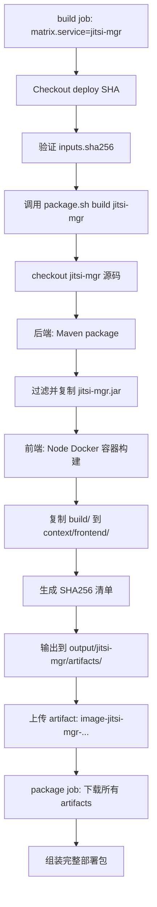

# jitsi-mgr GitHub Actions 集成

**状态：** 配置完成，待测试  
**日期：** 2026-11-25

---

## 📋 已完成工作

### 1. GitHub Actions 工作流更新 ✅

#### `build-package.yml`
- ✅ 在 `matrix.service` 中添加 `jitsi-mgr`
  ```yaml
  matrix:
    service: [gateway, app-web, api, jitsi-mgr, web, prosody, jicofo, jvb]
  ```

- ✅ 更新 package job 的服务列表（2处）
  ```bash
  for service in gateway app-web api jitsi-mgr web prosody jicofo jvb; do
  ```

- ✅ 更新 Python artifact 收集逻辑
  ```python
  for service in ('gateway','app-web','api','jitsi-mgr','web','prosody','jicofo','jvb'):
  ```

#### `build-joint.yml`
- ✅ 保持不变（通过 workflow_call 继承 build-package.yml 的更新）

### 2. 构建脚本更新 ✅

#### `build-tools/package.sh`

**服务验证更新：**
```bash
case "$service" in gateway|app-web|api|jitsi-mgr|web|prosody|jicofo|jvb) ;;
```

**新增 jitsi-mgr 构建分支：**
```bash
jitsi-mgr)
    # Backend: Spring Boot JAR
    (export JAVA_HOME="$java17" PATH="$java17/bin:$PATH"; \
     cd "$source/jitsi-mgr-app"; \
     python3 -B "$tools/maven-route.py" --audit ... -- -B -ntp -DskipTests package)
    
    # 过滤并复制 JAR（排除 -sources.jar 和 -javadoc.jar）
    cp jitsi-mgr.jar -> context/backend/
    
    # Frontend: React SPA
    # 创建 .env.production 指向相对 API 路径
    docker run node:24-trixie npm ci && npm run build
    
    # 复制前端构建产物
    cp -a build/. -> context/frontend/
    
    # 生成 SHA256 清单
    # 输出到 output/jitsi-mgr/artifacts/
    
    # 跳过 Docker 镜像创建
    return 0
```

**关键特性：**
- Maven 构建后端 JAR（使用 maven-route.py 代理）
- Node.js Docker 容器构建前端
- 生成独立的 SHA256 清单
- 输出到 `output/jitsi-mgr/artifacts/` 而不是 Docker 镜像
- 明确 `return 0` 跳过镜像保存逻辑

### 3. 源码锁定更新 ✅

#### `build-tools/sources.json`
```json
{
  "services": {
    ...
    "jitsi-mgr": {
      "repository": "https://github.com/stevenzxs/jitsi-mgr.git",
      "commit": "b3dafd0f7c102ec5ea9cb87856c8f3b1e5dc1a0d"
    },
    ...
  }
}
```

---

## 🔄 构建流程

### jitsi-mgr 在 Actions 中的执行流程



### 与其他服务的区别

| 服务 | Docker 镜像 | 输出格式 | 交付方式 |
|------|------------|----------|---------|
| gateway | ✅ | .tar.gz | GHCR + 包内 |
| app-web | ✅ | .tar.gz | GHCR + 包内 |
| api | ✅ | .tar.gz | GHCR + 包内 |
| **jitsi-mgr** | ❌ | JAR + 静态文件 | **包内 artifacts/** |
| web | ✅ | .tar.gz | GHCR + 包内 |
| prosody | ✅ | .tar.gz | GHCR + 包内 |
| jicofo | ✅ | .tar.gz | GHCR + 包内 |
| jvb | ✅ | .tar.gz | GHCR + 包内 |

---

## 📦 输出结构

### Actions Artifact
```
image-jitsi-mgr-{run_id}-{attempt}/
├── artifacts/
│   ├── jitsi-mgr.jar
│   ├── jitsi-mgr.jar.sha256
│   ├── jitsi-mgr-ui/
│   │   ├── index.html
│   │   ├── static/
│   │   └── ...
│   └── jitsi-mgr-ui.sha256
├── build-evidence.json
└── network-audit.*
```

### 最终部署包
```
cloudmeet-amd64-{run}-{attempt}.tar.gz
├── images/
│   ├── gateway.tar.gz
│   ├── app-web.tar.gz
│   ├── api.tar.gz
│   ├── web.tar.gz
│   ├── prosody.tar.gz
│   ├── jicofo.tar.gz
│   └── jvb.tar.gz
├── artifacts/
│   ├── jitsi-mgr.jar          ← 新增
│   ├── jitsi-mgr.jar.sha256   ← 新增
│   └── jitsi-mgr-ui/          ← 新增
│       └── (React build)
├── config/
│   ├── docker-compose.yml     (包含 jitsi-mgr 服务定义)
│   ├── Caddyfile              (包含 /api/mgr/* 路由)
│   └── jitsi-mgr.env
└── setup.py
```

---

## ⚙️ 运行时集成

### Docker Compose 服务
```yaml
jitsi-mgr:
  image: eclipse-temurin:17-jre
  restart: unless-stopped
  mem_limit: 1g
  working_dir: /app
  command: ['java', '-XX:MaxRAMPercentage=65', '-jar', '/app/jitsi-mgr.jar']
  volumes:
    - ./artifacts/jitsi-mgr.jar:/app/jitsi-mgr.jar:ro
    - ./data/jitsi-mgr:/app/data
  environment:
    SPRING_PROFILES_ACTIVE: ${JITSI_MGR_PROFILE:-prod}
    SPRING_DATASOURCE_URL: ${JITSI_MGR_DB_URL}
    SPRING_DATASOURCE_PASSWORD: ${JITSI_MGR_DB_PASSWORD}
  networks: [meet.jitsi]
```

### Caddy 路由
```caddy
@mgr_ui path /api/mgr/ui /api/mgr/ui/*
handle @mgr_ui {
    uri strip_prefix /api/mgr/ui
    root * /jitsi-mgr-ui
    file_server
    try_files {path} /index.html
}

@mgr_api path /api/mgr /api/mgr/*
handle @mgr_api {
    reverse_proxy jitsi-mgr:8080
}
```

### Gateway 卷挂载
```yaml
gateway:
  volumes:
    - ./artifacts/jitsi-mgr-ui:/jitsi-mgr-ui:ro
```

---

## 🔧 待完成任务

### 高优先级

1. **更新 `inputs.sha256`**
   ```bash
   cd D:/code/jitsi/deploy
   sha256sum build-tools/package.sh >> build-tools/inputs.sha256
   sha256sum build-tools/sources.json >> build-tools/inputs.sha256
   sha256sum .github/workflows/build-package.yml >> build-tools/inputs.sha256
   ```

2. **本地测试构建脚本语法**
   ```bash
   bash -n build-tools/package.sh
   python3 -c "import json; json.load(open('build-tools/sources.json'))"
   ```

3. **提交到配置库**
   ```bash
   git add .github/workflows/build-package.yml
   git add build-tools/package.sh
   git add build-tools/sources.json
   git commit -m "feat: integrate jitsi-mgr into GitHub Actions build pipeline"
   git push
   ```

### 中优先级

4. **更新 `publish.py`**
   - 修改发布脚本识别 jitsi-mgr（非 Docker 镜像）
   - 只发布七个 Docker 镜像到 GHCR
   - jitsi-mgr artifacts 包含在 GitHub Release

5. **更新组包逻辑**
   - 修改 `package.sh assemble` 阶段
   - 确保 jitsi-mgr artifacts 被正确打包
   - 验证最终 tar.gz 包含所有文件

6. **更新安装脚本**
   - `setup.py` 和 `deploy.py` 识别 jitsi-mgr artifacts
   - `init-jitsi-mgr.py` 集成到首次安装流程

### 低优先级

7. **测试端到端构建**
   - 手动触发 `build-package.yml`
   - 验证所有八个服务构建成功
   - 下载并检查最终部署包

8. **文档更新**
   - 更新 `build-tools/README.md`
   - 更新部署 Skills
   - 更新 AGENTS.md（已完成）

---

## ⚠️ 注意事项

### jitsi-mgr 特殊性

1. **不是 Docker 镜像服务**
   - 其他七个服务都构建 Docker 镜像
   - jitsi-mgr 输出 JAR 文件和静态文件
   - 运行时使用公共 `eclipse-temurin:17-jre` 镜像

2. **双制品输出**
   - 后端：单个 JAR 文件
   - 前端：整个 React build 目录
   - 两者需要同步版本

3. **Gateway 依赖**
   - 前端文件必须挂载到 gateway 容器
   - Caddy 配置必须包含路由规则

4. **初始化需求**
   - 首次部署需要运行 `init-jitsi-mgr.py`
   - 生成 JWT 密钥对
   - 生成数据库密码

### 构建依赖

- **后端：** Maven 3.6+, Java 17
- **前端：** Node.js 24, npm
- **Actions Runner：** ubuntu-24.04 或 ubuntu-24.04-arm 已预装

---

## 🧪 验证清单

- [ ] `package.sh` 语法检查通过
- [ ] `sources.json` JSON 格式有效
- [ ] `build-package.yml` YAML 格式有效
- [ ] `inputs.sha256` 已更新所有修改文件
- [ ] 本地 Git 状态干净
- [ ] 提交已推送到远程仓库
- [ ] 手动触发 Actions 工作流
- [ ] jitsi-mgr build job 成功
- [ ] jitsi-mgr artifacts 上传成功
- [ ] package job 包含 jitsi-mgr artifacts
- [ ] 最终 tar.gz 包含 jitsi-mgr.jar 和 jitsi-mgr-ui/
- [ ] SHA256 清单正确

---

## 📊 影响范围

### 修改文件
- `.github/workflows/build-package.yml` - 3 处修改
- `build-tools/package.sh` - 添加 ~45 行
- `build-tools/sources.json` - 1 条新记录

### 不修改文件
- `.github/workflows/build-joint.yml` - 通过继承自动获得更新
- `config/docker-compose.yml` - 已在前面完成
- `config/Caddyfile` - 已在前面完成
- `config/jitsi-mgr.env` - 已在前面完成

### 新增文件
- 无（构建脚本和初始化工具已存在）

---

## 🎯 成功标准

1. ✅ 八个服务全部构建成功
2. ✅ jitsi-mgr artifacts 包含 JAR 和前端
3. ✅ 最终部署包完整性检查通过
4. ✅ 所有 SHA256 清单一致
5. ⏳ 本地部署测试通过（后续）
6. ⏳ 客户端可访问 `/api/mgr/ui/`（后续）
7. ⏳ 后端 API `/api/mgr/v1/*` 正常工作（后续）

---

## 📝 下一步

1. 更新 `inputs.sha256`
2. 本地语法检查
3. 提交并推送
4. 手动触发 Actions 测试
5. 下载并检查构建产物
6. 更新发布和安装脚本
7. 完整端到端测试

**预计时间：** 构建配置完成 ✅，待 Actions 测试和集成
